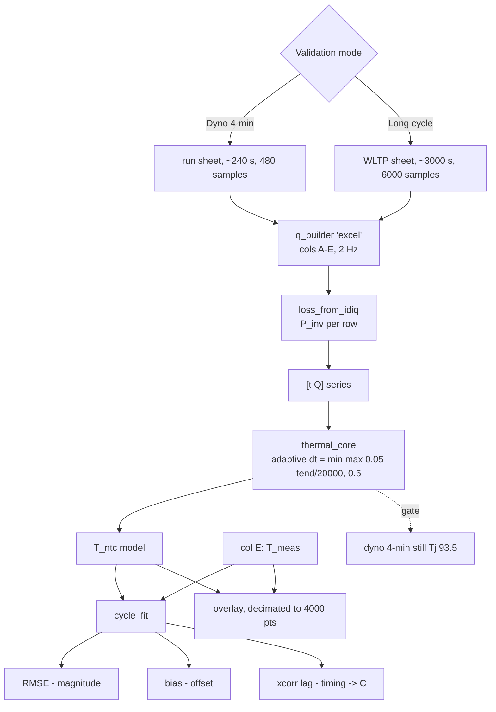

# Flowchart — long-cycle validation flow

## Three orthogonal metrics
- RMSE -> size error -> R / loss model
- bias -> constant offset
- lag  -> timing error -> capacitance C (first dynamic test of it)
