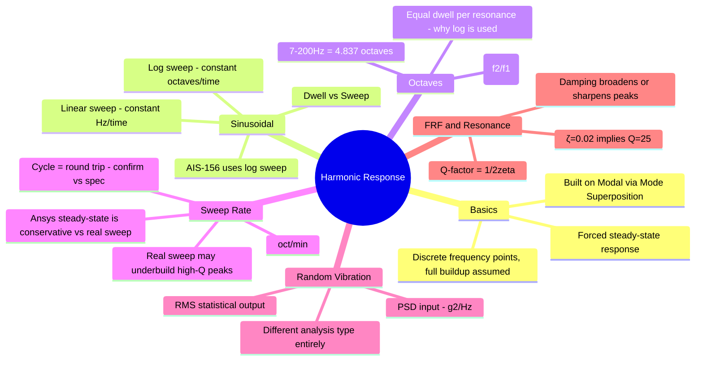

# Harmonic Response — Core Concepts + Math

> [!info] Ideaverse knowledge page
> Reusable engineering concept, captured from [[CPP_V2_Approach_and_TODO|CPP V2]] work. Prerequisite: [[Modal_Analysis_Fundamentals]]. Part 1 = concepts and terminology. Part 2 = full math, worked with CPP V2 numbers.

> [!warning] Read Part 2 §6 alongside Part 1 §D
> Part 1 §D says the Ansys steady-state solve is *conservative* compared with a real sweep. The math in Part 2 §6 refines this: for the CPP AIS-156 numbers, the steady-state assumption is **effectively exact**. Both kept here on purpose, so the reasoning trail is visible.

---

# PART 1 — Concepts & Terminology

## A. What Harmonic Response actually solves (vs Modal)

Modal analysis tells you how a structure wants to vibrate (frequencies + shapes), with no load. Harmonic Response answers: **if I shake this structure at a specific frequency forever, what's the steady-state amplitude of stress/deflection at every point?** It's forced, not free, vibration — and critically, **Ansys solves it as a series of discrete steady-state frequency points**, not a real-time sweep. At each frequency, it assumes the oscillation has had infinite time to fully build up — which matters a lot when we get to sweep rate below.

**Mode Superposition** (what we're using) builds this response as a weighted sum of mode shapes from the prior modal solve — each mode contributes according to its participation factor and how close the excitation frequency is to that mode's natural frequency. This is why modal analysis is a hard prerequisite, not a separate step.

## B. Sinusoidal excitation — the basic unit

A **sine dwell** = hold at one fixed frequency, let response fully stabilize, read the result. A **sine sweep** = continuously ramp the excitation frequency across a range (our 7–200 Hz) while exciting at a defined acceleration level per frequency. AIS-156 and most vibration standards use **sweep**, not dwell, because real-world vibration (road, transport) spans a frequency band, not one tone.

Two ways to ramp frequency with time:

- **Linear sweep**: df/dt = constant → frequency increases the same number of Hz every second. Spends very little *relative* time near low frequencies, a lot near high ones (in ratio terms).
- **Logarithmic sweep** (what AIS-156 uses): frequency increases at a constant *percentage rate* — f(t) = f₀ · 2^(t/T_oct). This means **equal time is spent per octave**, not per Hz.

**Why log sweep is the standard for structural testing:** a structure's resonant peaks have roughly constant **Q** (sharpness) in *relative* frequency terms — a peak at 20 Hz and a peak at 180 Hz both take roughly the same number of cycles to build up and decay. A log sweep gives every resonance across the band equal "dwell opportunity" regardless of where it sits; a linear sweep would unfairly rush through low-frequency resonances and linger pointlessly at high ones.

## C. Octaves — the unit log sweeps are built on

An **octave** = a frequency doubling (f₂ = 2·f₁), same term as in music. It's the natural log-sweep "distance" unit because log sweeps move at constant octaves/time.

**Number of octaves between two frequencies:**

**n = log₂(f₂/f₁) = ln(f₂/f₁) / ln(2)**

**Worked example — our actual AIS-156 band, 7 → 200 Hz:**

n = log₂(200/7) = log₂(28.571) = ln(28.571)/ln(2) = 3.3524/0.6931 = **4.837 octaves**

## D. Sweep rate — worked from our spec

Stored spec: 7–200 Hz, **15 min per cycle**, 12 cycles, vertical axis.

One important term to lock down first: a **"cycle"** in sweep-test terminology almost always means one **round trip** (low→high→low), not a one-way pass — worth confirming against the exact AIS-156 clause, both shown so the right one can be picked.

- One-way sweep = 4.837 octaves (from above)
- **If 15 min = one round trip** (7→200→7): total octaves traveled = 2 × 4.837 = 9.674 oct
  → Sweep rate = 9.674 / 15 = **0.645 octaves/min**
- **If 15 min = one-way only**: Sweep rate = 4.837 / 15 = **0.322 octaves/min**

**Total test duration** (vertical axis): 12 cycles × 15 min = **180 min = 3 hours**.

**Why sweep rate actually matters to the simulation, not just the physical test:** a real swept-sine test has a finite sweep rate, so a very lightly damped (high-Q) resonance might not have time to fully build up before the sweep moves past it — the true peak response can be *lower* than the theoretical steady-state peak. **The Ansys Harmonic Response solve does NOT model this** — Mode Superposition computes full steady-state amplitude at every discrete frequency point, as if dwelling there forever. That makes the simulation **conservative relative to the real swept test** — a legitimate and standard simplification, just know the stress numbers are an upper bound on what the physical sweep rate would actually produce, not an exact replica of it.

> [!note] Refined in Part 2 §6
> For the CPP numbers (ζ = 0.02, fₙ = 162.84 Hz, 0.645 oct/min), each resonance gets 5.37 s per pass against a 0.24 s build-up time, so the steady-state result is effectively exact, not just an upper bound.

## E. Random Vibration — how it differs from Harmonic (sinusoidal)

Different analysis type entirely, worth knowing even though the AIS-156 vertical sweep here is sinusoidal, not random:

| | Harmonic (Sinusoidal) | Random Vibration |
|---|---|---|
| Input | One deterministic frequency at a time, known amplitude & phase | All frequencies excited **simultaneously**, described statistically |
| Input definition | Acceleration (g) vs frequency table | **PSD** — Power Spectral Density, g²/Hz vs frequency |
| Output | Deterministic stress/deflection at each frequency (exact value) | Statistical — **RMS** response, reported as 1σ, 2σ, 3σ (probability bands) |
| Physical analogy | A tone sweeping through a band | Road noise, turbulence — broadband random shake |
| Ansys analysis type | Harmonic Response | Random Vibration (PSD) |

The AIS-156 test is sinusoidal sweep, so this stays out of the current workflow — but if a road-load random vibration qualification is ever asked for instead, that's a completely different solve (PSD input, RMS/statistical stress output, not a single peak value).

## F. FRF, Resonance, Q-factor — tying back to damping

- **Frequency Response Function (FRF):** response (stress or displacement) plotted vs frequency for the applied excitation — what we've been reading off the Equivalent Stress and Directional Deformation results.
- **Resonance:** where excitation frequency ≈ natural frequency → amplification peak in the FRF.
- **Q-factor (amplification factor):** Q = 1/(2ζ). Our ζ = 0.02 (2% damping) → **Q = 1/(2×0.02) = 25**. This means at true resonance, response can theoretically amplify up to ~25× the static/off-resonance response — a sanity-check number worth comparing against the actual FRF peak-to-baseline ratio.
- **Damping's role:** higher ζ → lower, broader peaks (more real-world energy dissipation); lower ζ → sharp, tall peaks (2% is fairly lightly damped — expect sharp peaks, meaning frequency accuracy matters more).

## Glossary — quick reference

| Term | Meaning |
|---|---|
| Dwell | Hold at one fixed frequency |
| Sweep | Continuously ramp frequency across a band |
| Octave | Frequency doubling (f₂ = 2f₁) |
| Log sweep | Constant octaves/time — equal time per frequency *ratio* |
| Linear sweep | Constant Hz/time — equal time per frequency *increment* |
| Sweep rate | Octaves/min (log) or Hz/min (linear) |
| Cycle | One round trip of the sweep (confirm vs one-way in the spec) |
| FRF | Response vs frequency curve |
| Q-factor | Resonant amplification = 1/(2ζ) |
| PSD | Power Spectral Density — g²/Hz, random vibration input |
| RMS | Root-mean-square — statistical response metric for random vibration |

## Mindmap — Concepts



---

# PART 2 — The Math (worked with CPP V2 numbers)

Every equation below has a CPP value plugged in, so it can be checked directly against the Ansys results.

## 1. Single-DOF forced response (where everything starts)

**Equation of motion** for a mass-spring-damper pushed by a sine force:

$$m\ddot{x} + c\dot{x} + kx = F_0 \sin(\omega t)$$

Define:
- $\omega_n = \sqrt{k/m}$ (natural frequency)
- $\zeta = c / (2m\omega_n)$ (damping ratio)
- $r = \omega/\omega_n$ (frequency ratio)

**Steady-state solution:** $x(t) = X \sin(\omega t - \phi)$, with

$$X = \frac{F_0/k}{\sqrt{(1-r^2)^2 + (2\zeta r)^2}} \qquad \tan\phi = \frac{2\zeta r}{1-r^2}$$

**Dynamic Magnification Factor (DMF):** how many times bigger the dynamic response is than the static one.

$$DMF = \frac{1}{\sqrt{(1-r^2)^2 + (2\zeta r)^2}}$$

**Worked, with ζ = 0.02:**

| r | Calculation | DMF | Meaning |
|---|---|---|---|
| 0.5 | 1/√(0.75² + 0.02²) = 1/√0.5629 = 1/0.7503 | **1.33** | below resonance, mild amplification |
| 1.0 | 1/√(0 + 0.04²) = 1/0.04 | **25.0** | resonance, so DMF = Q = 1/(2ζ) |
| 2.0 | 1/√((−3)² + 0.08²) = 1/3.001 | **0.33** | above resonance, isolation |

**Phase:** φ = 0° well below resonance, **90° at resonance**, 180° well above it. That 90° flip is how you tell a true resonance from a numerical spike in an FRF phase plot.

## 2. Base excitation: the math behind the inertial-load setup

The shaker moves the base with acceleration $\ddot{y} = A\sin(\omega t)$. Write the motion relative to the base, $z = x - y$:

$$m\ddot{z} + c\dot{z} + kz = -m\ddot{y}$$

The right-hand side, **−m·a**, is exactly the force produced by Fixed Support plus an Acceleration load on all bodies. That's the formal proof the CPP setup is valid.

**Relative displacement amplitude:**

$$Z = \frac{A}{\omega_n^2} \cdot DMF$$

**Absolute transmissibility** (what an accelerometer on the part reads compared with the shaker):

$$T = \frac{\sqrt{1 + (2\zeta r)^2}}{\sqrt{(1-r^2)^2 + (2\zeta r)^2}}$$

**Worked SDOF estimate for V2's 1st mode** (162.84 Hz, A = 20,000 mm/s² = 20 m/s²):
- ωₙ = 2π × 162.84 = 1023.2 rad/s
- ωₙ² = 1.0469 × 10⁶
- Static relative displacement = 20 / 1.0469×10⁶ = 1.910 × 10⁻⁵ m = **0.0191 mm**
- At resonance: 0.0191 × 25 = **0.478 mm**

Ansys gives 0.694 mm, so the hand calc lands in the right ballpark. The gap comes from the participation factor and the mode-shape amplitude at that node, plus other modes adding in (§3).

> [!question] Diagnostic hint
> The same SDOF estimate for **A1** (145.99 Hz) gives 0.0238 × 25 = **0.594 mm**, but Ansys says **0.0814 mm**. A1 sits about 7× below the "fully coupled" estimate and V2 doesn't. That points to A1's 1st mode barely coupling with Z-excitation (low participation) while V2's does. The participation summary will confirm or kill this — see [[Modal_Analysis_Fundamentals#E. Reading the Participation Summary table (Ansys output)]].

## 3. Mode superposition: how Ansys builds the multi-DOF answer

Write the physical displacement as a sum of mode shapes times modal coordinates:

$$\{x\} = \sum_{i=1}^{N} \{\phi_i\}\, q_i(t)$$

With mass-normalised modes, the coupled FE equations split into **N independent SDOF equations**, one per mode:

$$\ddot{q}_i + 2\zeta_i\omega_i\dot{q}_i + \omega_i^2 q_i = -\Gamma_i \, \ddot{y}$$

The participation factor Γᵢ is the "gain" that decides how strongly the base shake drives each mode.

**Steady-state solution per mode** (complex form):

$$q_i = \frac{-\Gamma_i A}{\omega_i^2 - \omega^2 + j\,2\zeta_i\omega_i\omega}$$

**Physical response at any node k:**

$$x_k(\omega) = \sum_i \phi_{k,i} \, q_i(\omega)$$

Stress is built the same way, from modal stresses.

**Reading this:** a mode contributes a lot only when all three of these are true:
1. Γᵢ is large (it couples with the excitation direction)
2. φₖ,ᵢ is large at the node of interest (the mode moves that location)
3. ω ≈ ωᵢ (close to resonance)

Lose any one of them and that mode's contribution collapses. That's the full mechanism behind the A1 vs V2 deflection gap.

## 4. Half-power bandwidth and why the Ansys frequency points cluster

The **resonance bandwidth**, measured between the points where response drops to 1/√2 of the peak:

$$\Delta f = 2\zeta f_n = \frac{f_n}{Q}$$

**Worked for V2's 1st mode:** Δf = 2 × 0.02 × 162.84 = **6.51 Hz**, so the band runs from about 159.6 to 166.1 Hz.

Compare the V2 Tabular Data: **159.65, 162.78, 162.84, 162.91, 166.1 Hz**. Those are the half-power edges plus a tight cluster at the peak. That's what **Cluster Number = 3** does: it puts solve points across each mode's half-power band so the sharp 2%-damped peak isn't missed by plain log spacing.

## 5. Octaves and log-sweep math

**Octave count:**

$$n = \log_2\frac{f_2}{f_1}$$

For 7 to 200 Hz: n = ln(28.571)/ln(2) = 3.3524/0.6931 = **4.837 octaves**

**Log sweep frequency vs time** (R = sweep rate in oct/min):

$$f(t) = f_1 \cdot 2^{R t} = f_1 \, e^{\beta t}, \qquad \beta = R \ln 2$$

**Time to sweep a band:**

$$t = \frac{\log_2(f_2/f_1)}{R}$$

**Sweep rate from the spec:**
- If 15 min is a round trip: R = 9.674 / 15 = **0.645 oct/min**
- If 15 min is one-way: R = 4.837 / 15 = **0.322 oct/min**

0.645 is used below. Confirm the round-trip vs one-way reading against the AIS-156 clause.

## 6. Time spent at resonance and whether steady-state is valid

**Time inside one mode's half-power band per pass (log sweep):**

$$\Delta t = \frac{\log_2(1 + 2\zeta)}{R} \approx \frac{2\zeta / \ln 2}{R}$$

- Band width in octaves = 0.04 / 0.6931 = 0.0577 oct
- Δt = 0.0577 / 0.645 = 0.0895 min = **5.37 s per pass**

**This doesn't depend on fₙ.** A mode at 20 Hz and a mode at 180 Hz each get the same 5.37 s. That's the mathematical reason log sweeps are fair.

**Compare a linear sweep** with the same one-way time (193 Hz in 7.5 min = 25.7 Hz/min):
- Mode at 162.84 Hz: Δf = 6.51 Hz, so Δt = 6.51/25.7 = 0.253 min = **15.2 s**
- Mode at 20 Hz: Δf = 0.8 Hz, so Δt = 0.8/25.7 = 0.031 min = **1.87 s**

The linear sweep rushes the low-frequency resonance by about 8×.

**Does the resonance have time to fully build?** The response time constant is

$$\tau = \frac{1}{\zeta\omega_n} = \frac{1}{0.02 \times 1023.2} = 0.0489\text{ s}$$

Reaching about 99% of steady state takes roughly 5τ = **0.24 s**. There are **5.37 s** in the band, about 22× more than needed.

> [!success] Correction to Part 1 §D
> Part 1 said the Ansys steady-state assumption is *conservative* compared with a real sweep. With the CPP numbers it's **effectively exact**: the resonance fully builds well inside each pass. Steady-state harmonic is a valid stand-in for this AIS-156 sweep, not just an upper bound. (Still worth re-checking for any future case with much lower damping or a much faster sweep.)

## 7. Cycle count, the fatigue link

**Total vibration cycles in one log sweep:**

$$N = \int f\,dt = \frac{f_2 - f_1}{\beta}$$

- β = 0.645 × 0.6931 / 60 = 0.007451 s⁻¹
- One-way: N = (200 − 7) / 0.007451 = **25,903 cycles**
- Round trip: about 51,806 cycles
- **Full test** (× 12): about **621,700 cycles**

**Cycles at near-peak stress** (inside the half-power band):
- Per pass: fₙ × Δt = 162.84 × 5.37 = **874 cycles**
- Passes in the test: 2 per round trip × 12 cycles = 24
- Total: 24 × 874 ≈ **21,000 cycles near peak stress**

**Why this matters:** the endurance limit of 32.5 MPa (Covestro 3040 PC FR ABS) is typically defined at 10⁶–10⁷ cycles. The test applies about 21k cycles near peak, well below that, and V2's 13.66 MPa is 2.38× under the endurance limit. So fatigue is comfortably safe here, and the math backs that up instead of it being assumed.

## 8. Acceleration vs displacement: what the AIS-156 step means

For sine motion:

$$a = (2\pi f)^2 \, d \quad\Rightarrow\quad d = \frac{a}{(2\pi f)^2}$$

**Worked against the CPP profile:**

| f (Hz) | a (m/s²) | (2πf)² | d (peak) |
|---|---|---|---|
| 7 | 10 | 1934 | **5.17 mm** |
| 18 | 10 | 12,791 | **0.78 mm** |
| 25 | 20 | 24,674 | **0.81 mm** |
| 200 | 20 | 1.579×10⁶ | **0.013 mm** |

The shaker displacement at 18 Hz and at 25 Hz is almost the same, about 0.8 mm. So the 1g-to-2g step is consistent with a **constant-displacement crossover** between those two points. The profile is also low-g, long-stroke at the bottom of the band (5.2 mm at 7 Hz) and high-g, tiny-stroke at the top. Useful for any shaker stroke-limit check.

## 9. Random vibration math (for contrast)

**Input:** a PSD, G(f) in g²/Hz. The overall input level is

$$G_{rms} = \sqrt{\int G(f)\,df}$$

**Response at a single dominant mode (Miles' equation):**

$$G_{rms,resp} = \sqrt{\frac{\pi}{2} \, f_n \, Q \, G(f_n)}$$

**Illustrative example** (flat 0.01 g²/Hz input, V2's mode at 162.84 Hz, Q = 25):
- Input level, flat from 20 to 2000 Hz: √(0.01 × 1980) = √19.8 = **4.45 g rms**
- Response: √(1.5708 × 162.84 × 25 × 0.01) = √63.95 = **8.0 g rms**
- **3σ peak** = 3 × 8.0 = **24 g** (exceeded only about 0.27% of the time)

The key difference from sine: random output is statistical (1σ, 2σ, 3σ), never one deterministic peak.

**Related unit:** a 1/3-octave band has f₂/f₁ = 2^(1/3) = 1.26. It's used for PSD and acoustic band definitions.

## Equation cheat-sheet

| Quantity | Formula | CPP value |
|---|---|---|
| DMF at resonance | Q = 1/(2ζ) | 25 |
| Half-power bandwidth | Δf = 2ζfₙ | 6.51 Hz (V2) |
| Octaves | log₂(f₂/f₁) | 4.837 |
| Sweep rate | n_total / t | 0.645 oct/min (round trip) |
| Dwell in band per pass | (2ζ/ln2)/R | 5.37 s |
| Build-up time constant | τ = 1/(ζωₙ) | 0.049 s |
| Cycles per one-way sweep | (f₂−f₁)/β | 25,903 |
| Cycles near peak (whole test) | fₙ·Δt·passes | ~21,000 |
| Displacement from accel | a/(2πf)² | 0.8 mm at the crossover |
| Miles' equation | √(π/2·fₙ·Q·PSD) | illustrative only |

## Mindmap — Math

```mermaid
mindmap
  root((Harmonic Response Math))
    SDOF Theory
      DMF = 1/sqrt of 1-r2 squared plus 2ζr squared
      Phase flips 90° at resonance
      Q = 1/2ζ = 25
    Base Excitation
      Relative eqn RHS = -m·a
      Proves inertial-load setup
      Z = A/ωn² × DMF
      Transmissibility T
    Mode Superposition
      x = Σ φ·q
      Uncoupled modal SDOF eqns
      Γ × φ at node × resonance proximity
    Bandwidth
      Δf = 2ζfn = 6.51 Hz
      Cluster points on half-power edges
    Log Sweep
      f = f1·2^Rt
      4.837 octaves
      Constant dwell per mode = 5.37 s
      τ = 0.049 s so steady-state valid
    Fatigue Link
      ~622k total cycles
      ~21k near peak
      Below 10^6 endurance basis
    Accel vs Disp
      d = a/(2πf)²
      0.8 mm crossover at 18-25 Hz
    Random
      PSD g²/Hz
      Miles equation
      RMS and 3σ
```

---

## Project application → [[CPP_V2_Problem_Statement]]

- Inertial-load setup (Fixed Support + Acceleration on all bodies) is formally equivalent to base excitation for stress/relative deformation (§2).
- Steady-state harmonic is effectively exact for this AIS-156 sweep (§6).
- Fatigue comfortably safe: ~21k near-peak cycles, V2 at 2.38× under endurance (§7).
- SDOF check suggests A1's 1st mode barely couples with Z while V2's does — pull the participation summary to confirm (§2 hint, [[CPP_V2_Approach_and_TODO]] TODO).

## Open items
- [ ] Confirm "15 min per cycle" = round trip or one-way from the AIS-156 clause (changes sweep rate 0.645 vs 0.322 oct/min; §6 conclusion holds either way, dwell doubles at 0.322).
- [ ] Pull participation summary for A1 and V2 to confirm the Z-coupling hypothesis.

## See also
- [[Modal_Analysis_Fundamentals]]
- [[CPP_V2_Problem_Statement]]
- [[CPP_V2_Approach_and_TODO]]
- [[CPP_V2_Progress_Log]]
